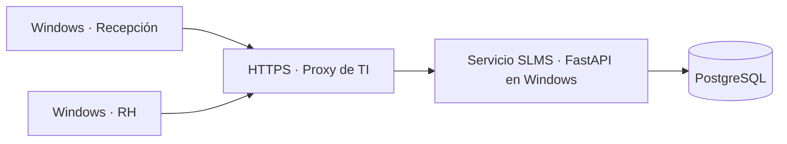

# SLMS — Samtec Locker Management System

Gestión de casilleros para Recursos Humanos y Recepción. Aplicación de escritorio
Windows con servicio central, inventario visual y trazabilidad de operaciones.

**Versión de la aplicación: 1.14.5. Estado: evaluación y piloto controlado.**
Documentación de entrega actualizada el 27 de octubre de 2026. Este repositorio
no acredita aprobación corporativa ni despliegue en producción.

## Empezar aquí

| Necesidad | Documento |
| --- | --- |
| Instalar servidor y conectar puestos | [Guía de despliegue para TI](docs/DESPLIEGUE_TI.md) |
| Revisar arquitectura, respaldos y seguridad actual | [Referencia técnica](docs/TI.md) |
| Aprender los procedimientos de operación | [Guía de uso](docs/OPERACION.md) |
| Evaluar lo pendiente de Microsoft | [Microsoft y correo](docs/MICROSOFT.md) |
| Revisar Android, iOS y próximas mejoras | [Propuestas de evolución](docs/ROADMAP.md) |
| Actualizar el repositorio con GitHub Desktop | [Guía GitHub](docs/GITHUB_ENTREGA.md) |
| Cargar los 118 bloques y preparar empleados | [Carga inicial](docs/CARGA_INICIAL.md) |
| Coordinar aceptación y responsables | [Lista de entrega](docs/ENTREGA_TI.md) |
| Consultar pruebas anteriores y su alcance | [Registro de validación](docs/VALIDACION.md) |

El ZIP del programa, los WI, las presentaciones y la carga inicial se entregan
por el canal interno de Samtec. Este repositorio es público: sus Releases también
lo son. La documentación interna no se adjunta automáticamente a GitHub.
El ZIP «Source code» de GitHub contiene código, no el ejecutable de Windows.
El WI y la capacitación requieren revisión documental.

Cambios de esta entrega: [Notas de SLMS 1.14.5](docs/RELEASE_1.14.5.md).

## Qué incluye esta versión

- Mapa satelital o de contornos; edificios, planos interiores/exteriores y pisos.
- Bloques móviles y rotables, búsqueda, creación de filas y vista previa.
- Casilleros con numeración, condición, notas y presencia de candado.
- Cuatro filas y tres columnas como valores iniciales editables; ocho recorridos
  de numeración mediante dos pasos perpendiculares.
- Empleados, asignaciones, traslados, devoluciones, bajas y reingresos.
- Revisiones físicas y seguimiento de disponibilidad: un casillero sin empleado
  registrado no se considera libre hasta verificarlo.
- Cortes de candado con responsable, estados y fotografías opcionales. El casillero
  queda en mantenimiento mientras el corte esté abierto y recupera la condición
  prevista al finalizar o cancelar, conservando su asignación.
- Historial consultable por fechas y detalle que resalta los campos modificados.
- Permisos, búsquedas, ordenación y acciones sobre filas marcadas.
- Importación de empleados CSV e intercambio de inventario Excel/CSV.
- Solicitudes locales persistentes, reintentos y detección de conflictos.
- Borradores de correo editables; apertura en Outlook u otro cliente predeterminado.
- Ajustes por cuenta/equipo, sincronización configurable entre 5 y 300 segundos
  y respaldos manuales de la base central.

**Límites actuales:** no hay aplicaciones Android/iOS, inicio Microsoft, envío
automático de correo ni integración con el padrón de HR. Los controles Microsoft
son previsiones deshabilitadas; requieren implementación, no solo configuración.
El envío manual se realiza y se comprueba en la aplicación de correo.

## Arquitectura actual



Cada puesto mantiene una copia local cifrada y su cola. PostgreSQL central es la
fuente de confirmación. Los clientes no necesitan credenciales de PostgreSQL.
El reloj de una laptop no decide quién obtiene un casillero ante un conflicto.

El servicio utiliza configuración Windows DPAPI ligada a la cuenta que la creó.
No es todavía un servicio nativo instalado automáticamente ni un servidor Linux
o contenedor listo para desplegar. TI debe supervisar su proceso y validar HTTPS.

## Ejecutar desde el código

Entorno de referencia: Windows, Python 3.13 de 64 bits y PostgreSQL 18 para el
servidor compartido. Las dependencias están fijadas en `requirements.txt`.
Desde PowerShell, en la raíz del repositorio:

```powershell
.\scripts\setup.ps1
& "$env:LOCALAPPDATA\SamtecLockers\venvs\dev\Scripts\python.exe" -m slms
```

La política de ejecución de scripts debe ser la permitida por TI. El asistente
permite PostgreSQL local, conexión a servidor HTTPS o demostración independiente.
La demostración de cada equipo tiene su propia base; no comparte datos con otros.

```powershell
# Pruebas aisladas e interfaz sin ventanas visibles
& "$env:LOCALAPPDATA\SamtecLockers\venvs\dev\Scripts\python.exe" -m pytest -q
# Pruebas con un clúster PostgreSQL 18 temporal; nunca la base operativa
& "$env:LOCALAPPDATA\SamtecLockers\venvs\dev\Scripts\python.exe" tests/run_postgres.py
# Distribución Windows
.\scripts\build.ps1
```

Los resultados y el alcance de las pruebas se registran en
[Validación](docs/VALIDACION.md). TI debe ejecutar el plan de aceptación en su
entorno antes de autorizar el piloto o la operación.

## Código y datos

| Carpeta | Contenido |
| --- | --- |
| `slms/` | Interfaz, API, reglas, sincronización y configuración |
| `migrations/` | Cambios de esquema Alembic |
| `assets/` | Logo, fuente, mapas iniciales y recursos gráficos |
| `scripts/` | Preparación, compilación y utilidades de entrega |
| `tests/` | Pruebas de dominio, permisos, concurrencia e interfaz |
| `config/` | Ejemplo de planificación Microsoft, sin secretos |
| `docs/` | Operación, despliegue, validación y propuestas |

El inventario inicial se entrega por el canal interno de Samtec, separado
del código y del ejecutable. La extracción del 20 de octubre de 2026 contiene
**118 bloques y 1.416 casilleros**, con posiciones, rotación y números de cuatro
dígitos. No incluye empleados, cuentas, asignaciones ni evidencias. Se acompaña
de los contornos actuales del mapa y de una plantilla de empleados vacía con
campos obligatorios y opcionales. Seguir [Carga inicial](docs/CARGA_INICIAL.md).

La base operativa completa, las credenciales y las listas de HR quedan fuera de
Git. La plantilla no contiene datos personales. La versión actual no fuerza
cuatro dígitos para todas las numeraciones que se creen después de esta carga.

## Acceso y evolución

El repositorio actual es público. TI debe definir su visibilidad y titularidad
para la entrega corporativa. Si pasa a privado, los revisores necesitarán acceso
explícito. La cuenta administradora inicial
de SLMS debe quedar bajo custodia definida por TI; es distinta del propietario
del repositorio y de la cuenta de Windows que ejecuta el servicio.

La evolución propuesta prioriza despliegue y recuperación, Microsoft, ajustes
administrativos completos, Android y posteriormente iOS. Cada etapa requiere
validación de alcance y aceptación: [Roadmap](docs/ROADMAP.md).

No se agrega una licencia de código abierto en esta entrega. La organización
debe definir las condiciones de uso y transferencia. Los recursos de terceros
mantienen sus atribuciones: [recursos visuales](assets/README.md).
